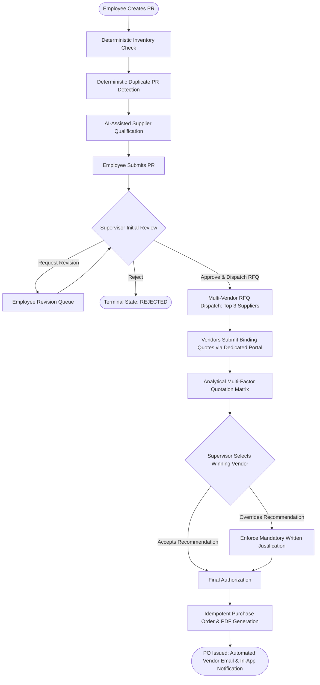
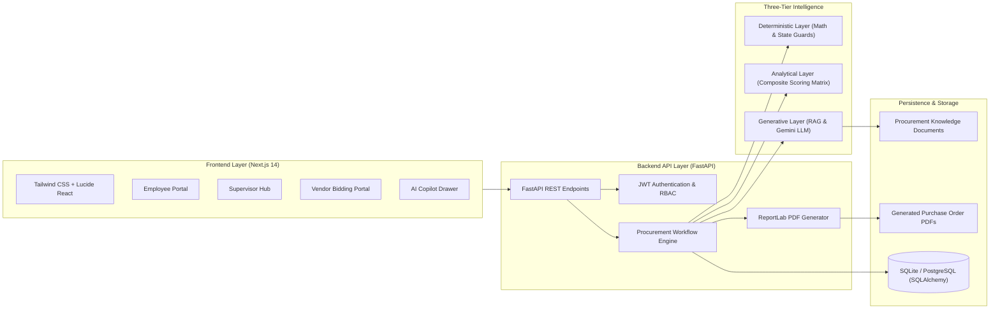

# Intelligent Procurement Management System (IPMS)

[](https://fastapi.tiangolo.com/)
[](https://nextjs.org/)
[](https://www.typescriptlang.org/)
[](https://www.python.org/)
[](https://tailwindcss.com/)
[](https://deepmind.google/technologies/gemini/)

> **A cloud-native, AI-augmented enterprise procurement platform designed to govern the entire requisition-to-procure lifecycle with zero hallucination, mathematical decision intelligence, multi-vendor RFQ bidding, and auditable PO generation.**

---

## Table of Contents
- [Executive Overview](#executive-overview)
- [The Enterprise Problem & Solution](#the-enterprise-problem--solution)
- [The Three-Tier Intelligence Paradigm](#the-three-tier-intelligence-paradigm)
- [System Architecture & Data Flow](#system-architecture--data-flow)
- [Core Features](#core-features)
- [Technology Stack](#technology-stack)
- [User Roles & Default Credentials](#user-roles--default-credentials)
- [Getting Started](#getting-started)
  - [Prerequisites](#prerequisites)
  - [Backend Setup](#backend-setup)
  - [Frontend Setup](#frontend-setup)
  - [Environment Configuration](#environment-configuration)
- [API Reference](#api-reference)
- [Testing & Quality Assurance](#testing--quality-assurance)
- [Project Directory Structure](#project-directory-structure)
- [License](#license)

---

## Executive Overview

In traditional corporate environments, procurement workflows are fragmented across spreadsheets, siloed ERP modules, and unstructured email threads. This results in **inventory blindness** (buying items that already sit in the warehouse), **accidental duplicate orders**, **vendor favoritism**, and **price-only selection traps** that lead to poor quality and missed delivery timelines.

The **Intelligent Procurement Management System (IPMS)** transforms requisitioning into an automated, auditable, and mathematically governed workflow. Built on a strict separation of **Deterministic Business Logic**, **Analytical Multi-Criteria Decision Analysis**, and **Generative/Agentic AI (RAG)**, IPMS ensures:
- 100% auditable inventory shortage and duplicate-order verification.
- Competitive multi-vendor Request for Quotation (RFQ) dispatching.
- Comprehensive 5-factor quotation scoring matrix (price, delivery speed, historical reliability, defect rate, and lead time velocity).
- Immutable, idempotent PDF Purchase Order (PO) creation with automated vendor alerts.

---

## The Enterprise Problem & Solution

| Enterprise Challenge | Traditional Vulnerability | IPMS Solution |
| :--- | :--- | :--- |
| **Inventory Blindness** | Employees place external vendor orders for items already abundantly stocked in internal warehouses. | **Deterministic Inventory Reconciliation**: Instantly computes $\text{Shortage} = \max(0, \text{Quantity} - \text{Stock})$ and prompts internal fulfillment. |
| **Duplicate Ordering** | Multiple team members submit identical or near-identical orders for the same project or department. | **±20% Windowing Heuristic**: Flags similar active requests within the department submitted within active operational windows. |
| **Vendor Bias** | Requesters favor familiar suppliers regardless of performance, pricing, or compliance history. | **Algorithmic Pre-RFQ Supplier Qualification**: Scored across past quality, pricing competitiveness, and SLA compliance. |
| **Lowest-Bidder Trap** | Procurement awards contracts solely to the lowest bidder, causing delayed deliveries and high defect rates. | **5-Factor Analytical Matrix**: Normalizes and balances cost against delivery velocity, historical reliability, and quality badges. |
| **Rogue Overrides** | Supervisors bypass recommendations without justification or compliance tracking. | **Enforced Justification Audit Trail**: Mandatory, validated justification logs whenever a supervisor overrides the top-scored vendor. |
| **PO Delays & Errors** | Manual PO drafting creates clerical errors, pricing discrepancies, and duplicate charges. | **Idempotent PDF Generation**: Generates legally-binding PO PDFs with secure verification hashes and automated vendor dispatch. |

---

## The Three-Tier Intelligence Paradigm

IPMS strictly isolates responsibilities across three complementary intelligence layers:

```
+-------------------------------------------------------------------------------+
|                      TIER 1: DETERMINISTIC INTELLIGENCE                       |
|  - Zero-hallucination math: Inventory stock shortage reconciliation           |
|  - ±20% Duplicate PR detection across active operational departmental windows  |
|  - Strict state-machine transitions (DRAFT -> SUBMITTED -> RFQ -> PO)         |
|  - Mandatory supervisor override justification validation                     |
+-------------------------------------------------------------------------------+
                                      │
+-------------------------------------▼-----------------------------------------+
|                       TIER 2: ANALYTICAL INTELLIGENCE                         |
|  - Pre-RFQ Multi-Factor Supplier Qualification Matrix                         |
|  - Post-RFQ 5-Factor Quotation Normalization & Composite Scoring Model        |
|  - Objective weightings: Unit Price (40%), Delivery Velocity (25%),           |
|    Historical Reliability (20%), Defect Rate (10%), Lead Time (5%)            |
+-------------------------------------------------------------------------------+
                                      │
+-------------------------------------▼-----------------------------------------+
|                   TIER 3: GENERATIVE & AGENTIC INTELLIGENCE                   |
|  - User-triggered Retrieval-Augmented Generation (RAG) over qualitative notes |
|  - Semantic embedding similarity across quarterly vendor performance surveys  |
|  - Executive rationale synthesis for supervisor audit reports                 |
|  - Interactive AI Procurement Policy Copilot                                  |
+-------------------------------------------------------------------------------+
```

---

## System Architecture & Data Flow

### Procurement Lifecycle Workflow



### High-Level Component Architecture



---

## Core Features

### 1. Unified Multi-Role Dashboard
- **Employee View**: Requisition initiation wizard, catalog browser, live inventory availability indicators, duplicate alert badges, and resubmission workbench.
- **Supervisor Hub**: Comprehensive queue of pending purchase requests, multi-vendor checking sheets, override controls, and historical audit logs.
- **Vendor Bidding Portal**: Dedicated interface where invited suppliers view dispatched RFQs and submit binding unit prices, lead times, and committed delivery dates.
- **Admin Database Viewer**: Built-in inspector for inventory levels, vendor profiles, audit logs, and system metrics.

### 2. Multi-Factor Quotation Evaluation
Quotations are scored through normalized analytical functions:
$$\text{Score} = w_p \cdot S_{\text{price}} + w_d \cdot S_{\text{delivery}} + w_r \cdot S_{\text{reliability}} + w_q \cdot S_{\text{quality}} + w_l \cdot S_{\text{lead\_time}}$$
- **Automatic Badge Awards**: Badges such as *"Lowest Price"*, *"Fastest Delivery"*, *"Top Historical Quality"*, or *"Recommended Choice"* are calculated dynamically without manual bias.

### 3. Supervisor Override Governance
- If a supervisor awards the contract to a supplier other than the mathematically highest-ranked vendor, IPMS locks the decision modal until a **detailed justification** is entered.
- Both the selected vendor and the justification reason are permanently recorded in the audit trail.

### 4. Idempotent Purchase Order & PDF Engine
- Generates official, tamper-evident corporate Purchase Orders formatted with corporate branding, item breakdown, tax summaries, payment terms, and vendor metadata using ReportLab.
- Subsequent calls for the same approved PR return the identical PO number and existing PDF path, guaranteeing idempotency.

### 5. Procurement Policy AI Copilot & Vendor RAG
- Grounded in local policy documents (`procurement_policy_2026.txt`, `supplier_code_of_conduct.txt`).
- Retrieves supplier historical reviews and provides human-readable explanations of vendor strengths, risks, and compliance scores.

---

## Technology Stack

### Backend
- **Framework**: [FastAPI](https://fastapi.tiangolo.com/) (Python 3.10+)
- **Server**: [Uvicorn](https://www.uvicorn.org/) (ASGI, asynchronous event loop)
- **ORM & Database**: [SQLAlchemy](https://www.sqlalchemy.org/) with SQLite (WAL mode enabled) / PostgreSQL-compatible
- **Validation**: [Pydantic v2](https://docs.pydantic.dev/)
- **PDF Generation**: [ReportLab](https://www.reportlab.com/)
- **AI Integration**: [Google GenAI SDK](https://github.com/google-gemini/generative-ai-python) (Gemini 2.0 Flash / Pro) with cosine similarity vector retrieval
- **Testing**: [Pytest](https://docs.pytest.org/)

### Frontend
- **Framework**: [Next.js 14](https://nextjs.org/) (React 18, App Router)
- **Language**: [TypeScript](https://www.typescriptlang.org/)
- **Styling**: [Tailwind CSS](https://tailwindcss.com/)
- **Icons**: [Lucide React](https://lucide.dev/)
- **Networking**: Client-side fetch with typed API wrappers and error handlers

---

## User Roles & Default Credentials

The system comes pre-seeded with enterprise accounts across all operational roles:

| Role | Username | Password | Access Scope |
| :--- | :--- | :--- | :--- |
| **Employee** | `employee_john` | `password123` | Create PRs, view status, respond to revision requests |
| **Supervisor** | `supervisor_sarah` | `password123` | Approve/reject PRs, dispatch RFQs, evaluate quotes, authorize POs |
| **Vendor 1** | `vendor_apex` | `password123` | Apex Solutions supplier portal (submit quotes for RFQs) |
| **Vendor 2** | `vendor_summit` | `password123` | Summit Industrial supplier portal |
| **Vendor 3** | `vendor_vanguard`| `password123` | Vanguard Components supplier portal |
| **Admin** | `admin` | `password123` | Master database, audit log, and catalog control |

---

## Getting Started

### Prerequisites
- **Node.js**: v18.0.0 or higher (v20+ recommended)
- **Python**: v3.10 or higher
- **Git**

### Backend Setup

1. **Navigate to the backend directory**:
   ```bash
   cd backend
   ```

2. **Create and activate a virtual environment**:
   ```bash
   # Windows (PowerShell)
   python -m venv .venv
   .\.venv\Scripts\Activate.ps1

   # Linux / macOS
   python3 -m venv .venv
   source .venv/bin/activate
   ```

3. **Install dependencies**:
   ```bash
   pip install -r requirements.txt
   ```

4. **Initialize the database and seed demo data**:
   ```bash
   python migrate.py
   ```

5. **Start the FastAPI backend server**:
   ```bash
   python -m uvicorn app.main:app --host 127.0.0.1 --port 8000 --reload
   ```
   The backend API will be available at `http://127.0.0.1:8000`.
   Interactive Swagger documentation is accessible at `http://127.0.0.1:8000/docs`.

### Frontend Setup

1. **Navigate to the frontend directory**:
   ```bash
   cd frontend
   ```

2. **Install npm dependencies**:
   ```bash
   npm install
   ```

3. **Start the development server**:
   ```bash
   npm run dev
   ```
   Open your browser and navigate to `http://localhost:3000`.

### Environment Configuration

Configure custom environment variables by copying `.env.example` or creating a `.env` file in `backend/`:

```env
# Server
HOST=127.0.0.1
PORT=8000
ENVIRONMENT=development

# Database
DATABASE_URL=sqlite:///./procurement.db

# Security
SECRET_KEY=enterprise_super_secret_procurement_key_2026
ACCESS_TOKEN_EXPIRE_MINUTES=1440

# AI Configuration (Optional: defaults to local heuristic provider if unset)
AI_ENABLED=true
LLM_PROVIDER=gemini # Options: "gemini", "mock_local"
GEMINI_API_KEY=your_gemini_api_key_here
GEMINI_MODEL=gemini-2.0-flash
```

---

## API Reference

| Method | Endpoint | Description |
| :--- | :--- | :--- |
| `POST` | `/api/v1/auth/login` | Authenticate user and issue JWT token |
| `GET` | `/api/v1/catalog/items` | Retrieve procurement item catalog with stock levels |
| `GET` | `/api/v1/purchase-requests` | List purchase requests (filtered by user role) |
| `POST` | `/api/v1/purchase-requests` | Create a new purchase request |
| `GET` | `/api/v1/purchase-requests/{id}` | Get complete PR details with items, quotes, and audit logs |
| `POST` | `/api/v1/purchase-requests/{id}/initial-review` | Supervisor approve, request revision, or reject PR |
| `POST` | `/api/v1/rfqs/dispatch` | Dispatch competitive RFQs to top 3 qualified suppliers |
| `POST` | `/api/v1/quotations/submit` | Vendor submits unit price, lead time, and delivery date |
| `POST` | `/api/v1/purchase-requests/{id}/select-vendor` | Supervisor awards winning quote (with justification if overriding) |
| `POST` | `/api/v1/purchase-orders/generate` | Generate idempotent legally-binding PO and PDF |
| `GET` | `/api/v1/purchase-orders/{id}/download` | Download generated PO PDF document |
| `POST` | `/api/v1/ai/copilot` | Context-aware AI Procurement Assistant |
| `GET` | `/api/v1/admin/db-tables` | Admin database inspector endpoint |

---

## Testing & Quality Assurance

The codebase includes an extensive suite of automated tests verifying deterministic logic, scoring models, and state workflows:

```bash
cd backend
.\.venv\Scripts\pytest tests/ -v
```

### Verified Test Assertions
- `test_inventory_shortage_calculation`: Validates accurate stock subtraction and fulfillment status.
- `test_duplicate_pr_detection`: Validates ±20% quantity window heuristics across non-terminal requests.
- `test_analytical_scoring_matrix`: Validates multi-factor formula, normalization, and badge allocation.
- `test_supervisor_override_enforcement`: Verifies rejection of overrides without adequate written justification.
- `test_idempotent_po_generation`: Verifies that re-triggering PO creation returns the identical PO number without duplicating storage records.

---

## Project Directory Structure

```
Intelligent-Procurement-Management-System/
├── backend/
│   ├── app/
│   │   ├── ai/                      # RAG, LLM provider, and cosine similarity models
│   │   ├── api/
│   │   │   ├── routes/              # REST route controllers (PR, RFQ, PO, Auth, AI, Admin)
│   │   │   └── deps.py              # Dependency injection and JWT verification
│   │   ├── core/                    # App configuration, security, and database engine
│   │   ├── intelligence/            # Deterministic business rules & Analytical scoring matrix
│   │   ├── models/                  # SQLAlchemy ORM entity definitions
│   │   ├── schemas/                 # Pydantic v2 domain validation schemas
│   │   └── services/                # Workflow orchestration, PO generation, notifications
│   ├── storage/
│   │   ├── knowledge_documents/     # Corporate procurement policy docs for RAG
│   │   └── purchase_orders/         # Generated PO PDFs
│   ├── tests/                       # Pytest automated test suite
│   ├── migrate.py                   # Database migration and seeding script
│   └── requirements.txt             # Backend dependencies
├── frontend/
│   ├── app/                         # Next.js App Router (pages and layouts)
│   ├── components/                  # UI components (Checking Sheet, Copilot, Modals)
│   ├── lib/                         # Typed API client, workflow helpers, sync services
│   ├── tailwind.config.js           # Tailwind design configuration
│   └── tsconfig.json                # TypeScript compiler configuration
├── FINAL_SYSTEM_DOCUMENTATION.md    # Master architectural & technical documentation
├── .gitignore                       # Production gitignore
└── README.md                        # Master project documentation
```

---

## License

This project is licensed under the [MIT License](LICENSE).
